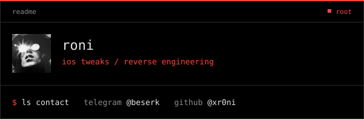

<p align="center">
  
</p>

```console
$ whoami
roni

$ cat about
i love reverse engineering ios ipas,  android apks and tear them apart to see how they work.
dylibs, hooks, private apis. if it runs on a phone, i want to know what it's doing.
```

### `$ ls skills`

```text
ios                objective-c · theos / logos · dylib injection · uikit
jailbreak          dopamine · trollstore · rootless · arm64 / arm64e
reversing          private mobile + web apis · traffic analysis · request replay
python, golang     automation · threading · proxies · sessions · pillow
backend            node · express · webhooks · crypto checkout
```

### `$ ls projects`

```text
Snapchat v14.28.1        · SSL (gRPC) bypass
TikTok v47.1.4           · SSL bypass, x-argus x-gorgon full offline reproduction
Threads v450.0.0.31      · SSL bypass
Instagram  v450.0.0.31   · SSL bypass
```

### `$ ls contact`

```text
telegram   @beserk    https://t.me/beserk
github     @xr0ni     https://github.com/xr0ni
```
